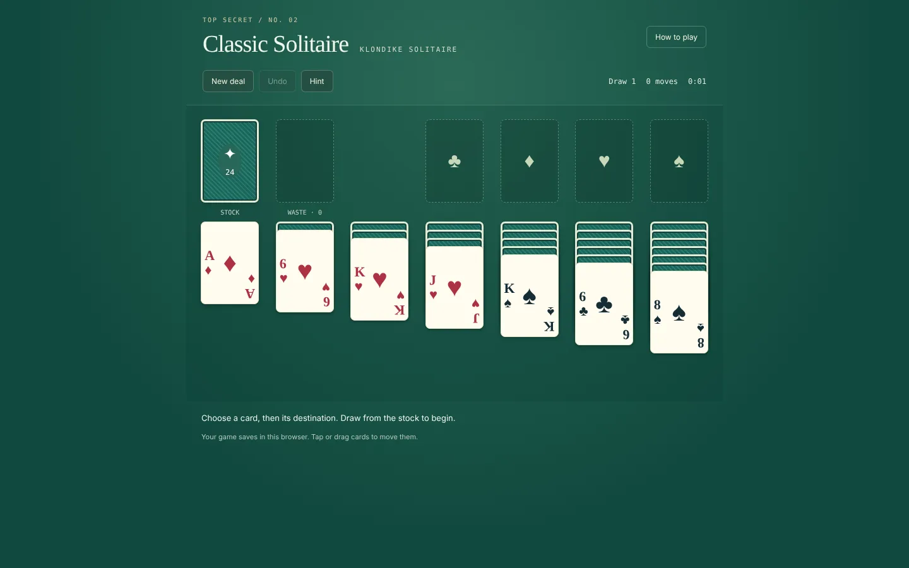
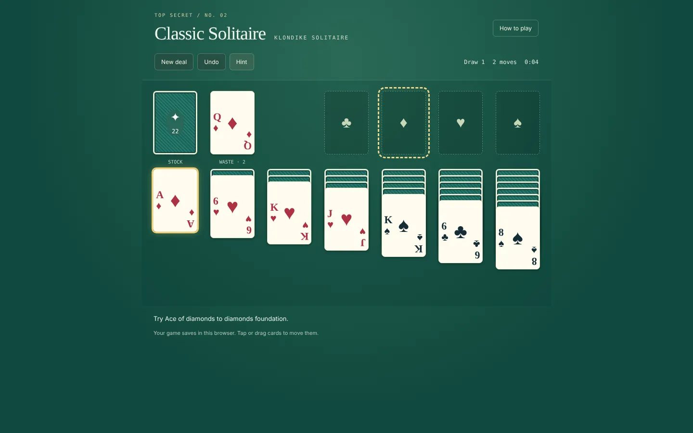
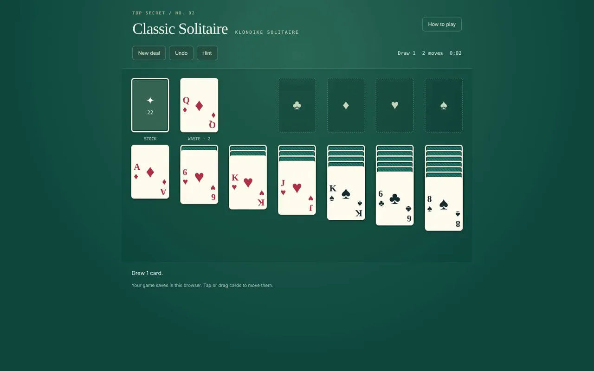

# Classic Solitaire

**Draw one or three, undo a move and bring all four suits home.**

[**▶ Live demo**](https://beebopcat.github.io/classic-solitaire/) · [**Play on caseyshingledecker.com**](https://caseyshingledecker.com/demos/top-secret/solitaire/) · [**Source**](https://github.com/Beebopcat/classic-solitaire)

[](https://beebopcat.github.io/classic-solitaire/)

*Promotional cover art; gameplay screenshots appear below.*

## What it is

Classic Klondike solitaire: draw one or three, undo a move and bring all four suits home.

## Screenshots

| | |
|:--:|:--:|
|  |  |
| <sub>Classic Solitaire board at the start of a Klondike deal, with stock, waste, seven tableau columns and four empty foundations.</sub> | <sub>Board after drawing from the stock, with the 2 of spades showing in the waste pile and the move counter at 2.</sub> |
|  |  |
| <sub>Hint highlighting the 3 of diamonds and the 4 of clubs, with the status line about moving the 3 of diamonds.</sub> | <sub>Board with a 9 of spades selected and outlined in gold, with the hint line about building foundations from Ace to King.</sub> |

### Video

[](docs/media/clip.mp4)

*Click the poster to open the short screen recording (docs/media/clip.mp4).*

## How to play

1. Build the four foundation piles from Ace to King by suit.
2. The seven columns build down in alternating colors; Kings fill empty columns.
3. Click or tap a face-up card and then its destination, drag it, or double-click a top card to send it to its foundation.
4. Click the stock to draw cards. The waste can be recycled with unlimited redeals.
5. Use the buttons: New deal, Undo, Hint, Finish game (when safe) and Draw 1 / Draw 3.

**Controls**

- Mouse or touch: click/tap a card then its destination, drag, or double-click a top card to send it to its foundation
- Keyboard: Tab to move between cards, Enter or Space to select, Escape to cancel, Ctrl+Z to undo

### Quick start


<sub>Board with a 9 of spades selected and outlined in gold, with the hint line about building foundations from Ace to King.</sub>

## Features

- Draw 1 or Draw 3
- Undo
- Hint
- Finish game when safe
- Move counter and timer
- The game saves in the browser
- Keyboard accessible
- Unlimited redeals of the waste

## The story behind it

Part of Casey's Arcade. Some shuffled deals cannot be won, and the game says so.

## Built with

- HTML and JavaScript (solitaire.js)

## Run it locally

This is a static web project, so any local web server works:

```bash
git clone https://github.com/Beebopcat/classic-solitaire.git
cd classic-solitaire
python -m http.server 8000
```

Then open http://localhost:8000 in your browser.

## Credits & disclaimers

Built by Casey Shingledecker with AI-assisted development.

## More projects

- Portfolio and live demos: https://caseyshingledecker.com/
- All repositories: https://github.com/Beebopcat

## License

Copyright (c) 2026 Casey Shingledecker. All rights reserved. Source-available for viewing and for personal, non-commercial running only; this is not open source. See [LICENSE](LICENSE). Other people's material keeps its own license.
